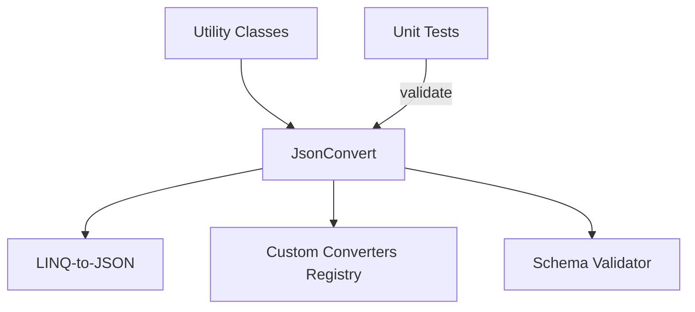

# JamesNK/Newtonsoft.Json

> .NET library for JSON serialization and manipulation, aimed at C# developers.

## The problem
Reading and writing JSON in .NET requires a reliable serialization engine, with object conversion and dynamic access.

## What it actually does
The README contains only links. From the described architecture: `JsonConvert`, `JsonReader` and `JsonWriter` form the core, with LINQ-to-JSON (`JObject`, `JArray`), customizable converters and a schema module. The repository also contains tests, fuzzing tests and build scripts.

## How it is wired

## Trying it
No command documented in the README.

## Cost and gotchas
Free. Requires .NET. The README gives no instructions; 825 open issues.

## What it is not
Not a Python library, nor cross-platform outside .NET. The README describes none of its capabilities.

## Alternatives
No alternative named in the README.

## For you
Ignore: only useful for .NET projects; without C# code, nothing to gain from it.
