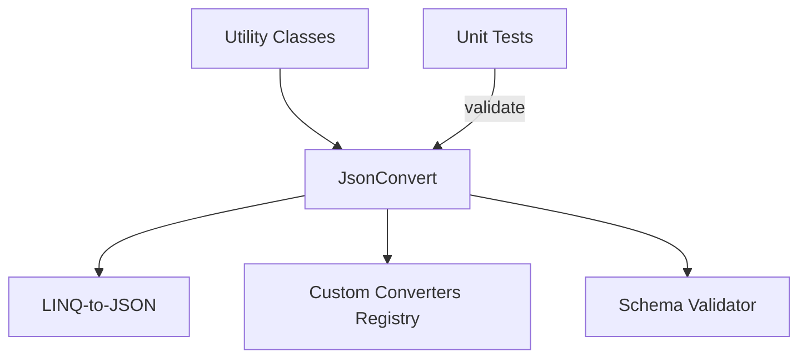

# JamesNK/Newtonsoft.Json

> Bibliothèque .NET de sérialisation et de manipulation JSON, destinée aux développeurs C#.

## Le problème
Lire et écrire du JSON en .NET demande un moteur de sérialisation fiable, avec conversion d'objets et accès dynamique.

## Ce que ça fait vraiment
Le README ne contient que des liens. D'après l'architecture décrite : `JsonConvert`, `JsonReader` et `JsonWriter` forment le cœur, avec LINQ-to-JSON (`JObject`, `JArray`), des convertisseurs personnalisables et un module de schéma. Le dépôt contient aussi tests, tests de fuzzing et scripts de build.

## Comment c'est branché

## Essayer
Aucune commande documentée dans le README.

## Coût et pièges
Gratuit. Il faut .NET. Le README ne donne aucune instruction ; 825 issues ouvertes.

## Ce que ce n'est pas
Pas une bibliothèque Python ni multiplateforme hors .NET. Le README ne décrit rien de ses capacités.

## Alternatives
Aucune alternative nommée dans le README.

## Pour toi
À ignorer : uniquement utile pour des projets .NET ; sans code C#, rien à en tirer.

