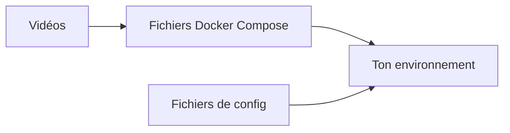

# JamesTurland/JimsGarage

> Collection of Docker Compose and configuration files that accompany Jim's Garage videos.

## The problem
Reproducing the setups shown in videos means copying the configuration files by hand.

## What it actually does
The README is two lines long: Docker Compose and configuration files to adapt to your environment, then deploy. Nothing else is documented: no list of services, no architecture.

## How it is wired

Simplified diagram based on the sheet, no diagram provided.

## Trying it
```bash
# Aucune commande documentée dans le README : adapter les fichiers Compose puis les déployer.
```

## Cost and gotchas
Free, but Docker is required. No license is declared: reuse is not governed.

## What it is not
It is not a documented project or a tool: it is a folder of companion files, to be read alongside the videos.

## Alternatives
No alternative named in the README.

## For you
Ignore: insufficient material and no license, with no value of its own outside the videos.
