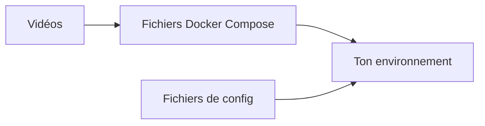

# JamesTurland/JimsGarage

> Collection de fichiers Docker Compose et de configuration accompagnant les vidéos de Jim's Garage.

## Le problème
Reproduire les montages montrés dans des vidéos oblige à recopier les fichiers de configuration à la main.

## Ce que ça fait vraiment
Le README tient en deux lignes : des fichiers Docker Compose et de configuration à adapter à son environnement, puis à déployer. Rien d'autre n'est documenté : ni liste de services, ni architecture.

## Comment c'est branché

Schéma simplifié d'après la fiche, sans diagramme fourni.

## Essayer
```bash
# Aucune commande documentée dans le README : adapter les fichiers Compose puis les déployer.
```

## Coût et pièges
Gratuit, mais Docker requis. Aucune licence n'est déclarée : la réutilisation n'est pas encadrée.

## Ce que ce n'est pas
Ce n'est pas un projet documenté ni un outil : c'est un dossier de fichiers d'accompagnement, à lire avec les vidéos.

## Alternatives
Aucune alternative nommée dans le README.

## Pour toi
À ignorer : matière insuffisante et licence absente, sans valeur propre hors des vidéos.

