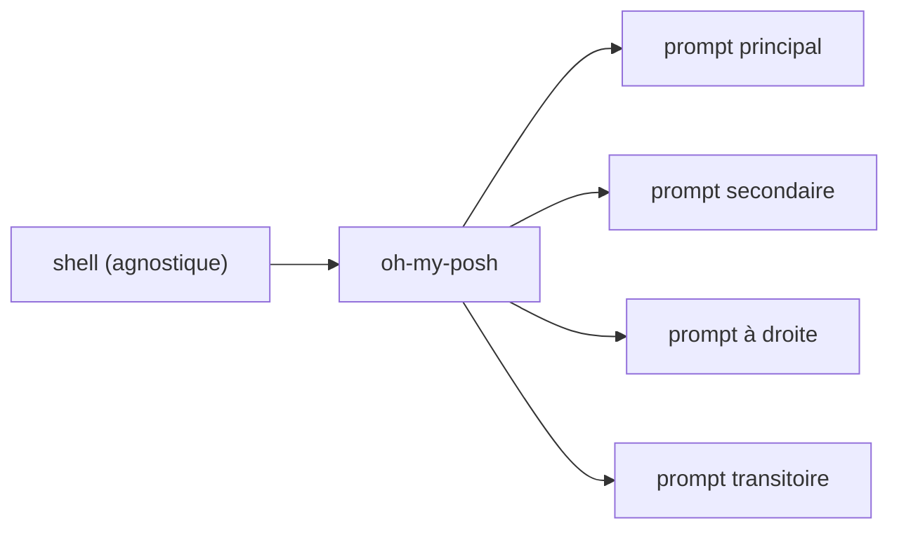

# JanDeDobbeleer/oh-my-posh

> Prompt theme engine, advertised as independent of shell and platform.

## The problem
A useful terminal prompt (git branch, cloud context, command duration) is hacked together shell by shell,
and the work has to be redone whenever you change machine or shell.

## What it actually does
The README as provided contains only a list of features: shell- and platform-agnostic, configurable, fast, secondary prompt, right-side prompt, transient prompt. The
"Documentation" and "Reviews" sections have no content, apart from a link to a review by
TameWizard. No description of the configuration format or of the theme mechanism is given here.

## How it is wired

## Trying it
No installation command is documented in this README.

## Cost and gotchas
Nothing is stated: no license, no prerequisites, no dependencies. The README points to external
documentation that is not reproduced here.

## What it is not
Not a shell nor a shell configuration framework: it only handles prompt display.
Not documented in this file — any adoption decision means going to read the project's site.
The "most configurable" claim is a README assertion, not a fact verifiable here.

## Alternatives
No alternative is named in the README.

## For you
Terminal comfort, with no effect on your data work; worth a look on a workstation tidy-up day.
