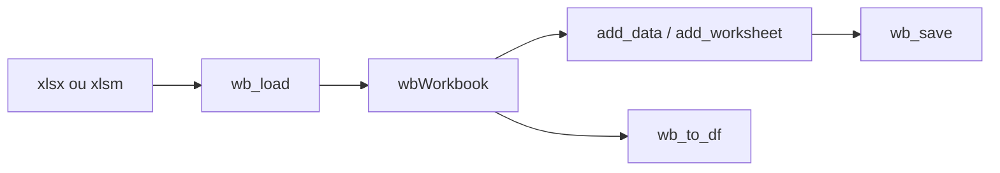

# JanMarvin/openxlsx2

> R package to read, create and modify xlsx, xlsm and xlsb (limited) workbooks, successor to openxlsx.

## The problem
Handling Excel files from R without Excel, including styles, tables and named ranges.

## What it actually does
Two modes: R objects (`read_xlsx()`, `write_xlsx()`) or `wbWorkbook` objects (`wb_load()`, `wb_workbook()`) to add sheets, modify cells and formatting, then save. Relies on an XML library and works well with pipes.

## How it is wired


## Trying it
```r
install.packages('openxlsx2')
library(openxlsx2)
wb <- wb_workbook()
wb$add_worksheet("sheet")
wb$add_data("sheet", cars)
```

## Cost and gotchas
Free. Other spreadsheet formats are not supported. License present but not recognized by GitHub: to be checked (CRAN package).

## What it is not
Not a calculation engine: formulas are not evaluated. A team of volunteers, variable response times.

## Alternatives
openxlsx (predecessor cited in the README).

## For you
Adopt if you produce Excel reports from R; check the license, of no interest in Python.
