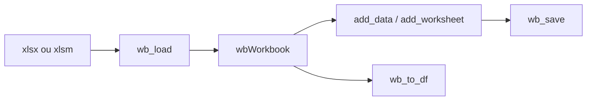

# JanMarvin/openxlsx2

> Paquet R pour lire, créer et modifier des classeurs xlsx, xlsm et xlsb (limité), successeur d'openxlsx.

## Le problème
Manipuler des fichiers Excel depuis R sans Excel, y compris styles, tables et plages nommées.

## Ce que ça fait vraiment
Deux modes : objets R (`read_xlsx()`, `write_xlsx()`) ou objets `wbWorkbook` (`wb_load()`, `wb_workbook()`) pour ajouter des feuilles, modifier cellules et mise en forme, puis enregistrer. S'appuie sur une bibliothèque XML et se prête aux pipes.

## Comment c'est branché


## Essayer
```r
install.packages('openxlsx2')
library(openxlsx2)
wb <- wb_workbook()
wb$add_worksheet("sheet")
wb$add_data("sheet", cars)
```

## Coût et pièges
Gratuit. Autres formats de tableur non pris en charge. Licence présente mais non reconnue par GitHub : à vérifier (paquet CRAN).

## Ce que ce n'est pas
Pas un moteur de calcul : les formules ne sont pas évaluées. Équipe de bénévoles, délais variables.

## Alternatives
openxlsx (prédécesseur cité dans le README).

## Pour toi
À adopter si tu produis des rapports Excel depuis R ; vérifie la licence, sans intérêt en Python.

