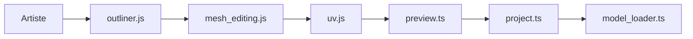

# JannisX11/blockbench

> Free 3D editor for low-poly models with pixel-art textures, with Minecraft formats.

## The problem
Creating textured low-poly models for games or Minecraft requires heavy 3D tools, poorly suited to pixel art.

## What it actually does
Desktop (Electron) and web editor: model hierarchy (outliner), mesh editing, UV, texture painting, animation (timeline), 3D preview. Export to standardized formats (glTF) and dedicated Minecraft Java and Bedrock formats. JavaScript plugin system.

## How it is wired


## Trying it
```bash
npm install
npm run dev
npm run serve   # version web sur http://localhost:3000
```

## Cost and gotchas
Free. The README recommends downloading the application from the website rather than compiling. 665 open issues.

## What it is not
Not a high-end modeling tool nor AI generation: a manual editor for cube-and-pixel models.

## Alternatives
No alternative named in the README.

## For you
Ignore: 3D creation tool for games, outside your scope, except for an occasional need for assets.
