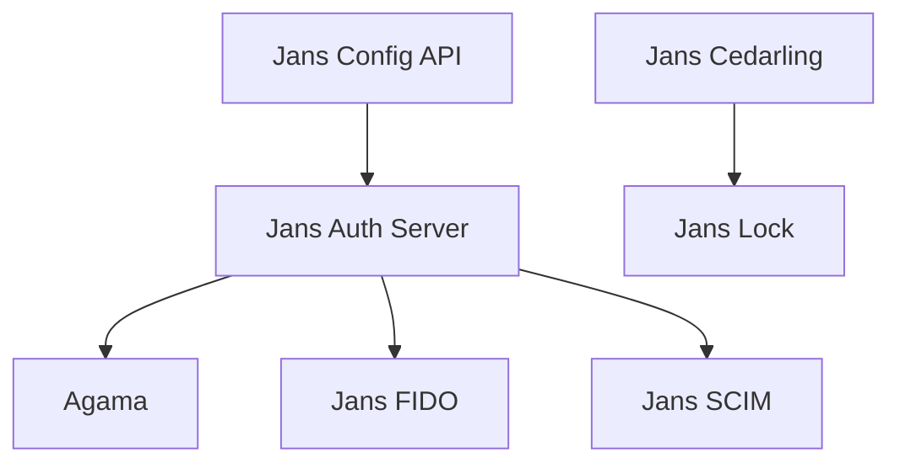

# JanssenProject/jans

> Open source identity and access platform (OAuth, OpenID Connect, FIDO), under the Linux Foundation.

## The problem
A company that handles authentication itself has to assemble an OAuth server, passkeys, user management and authorization policies.

## What it actually does
Bundles Jans Auth Server (a certified OpenID provider, in Java), Agama (authentication flows), FIDO, SCIM, Config API, Casa (user portal), Cedarling (policy engine in Rust) and Lock. Installation through Helm, Docker (not for production) or VM packages.

## How it is wired
Simplified diagram based on the sheet, no diagram provided.

## Trying it
No command in the README: installation is deferred to the documentation (Helm, Docker, packages).

## Cost and gotchas
Production deployment on Kubernetes. The Gluu team leads the project and sells a commercial distribution (Gluu Flex, Gluu Solo). 518 open issues.

## What it is not
Not a simple tool: an enterprise identity stack. Several components are at different maturity stages.

## Alternatives
None cited in the README. Gluu Flex is the commercial version.

## For you
Ignore: identity and access domain, outside the scope of a data / AI profile, unless you operate authentication yourself.
