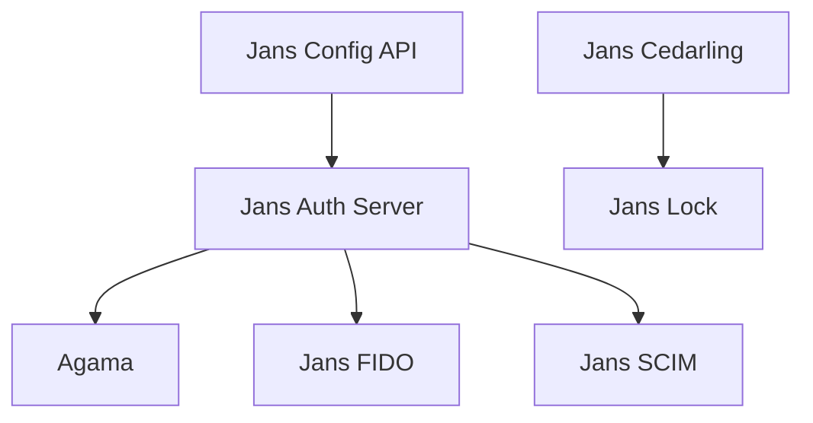

# JanssenProject/jans

> Plateforme open source d'identité et d'accès (OAuth, OpenID Connect, FIDO), sous la Linux Foundation.

## Le problème
Une entreprise qui gère l'authentification elle-même doit assembler serveur OAuth, passkeys, gestion des utilisateurs et politiques d'autorisation.

## Ce que ça fait vraiment
Regroupe Jans Auth Server (fournisseur OpenID certifié, en Java), Agama (parcours d'authentification), FIDO, SCIM, Config API, Casa (portail utilisateur), Cedarling (moteur de politiques en Rust) et Lock. Installation par Helm, Docker (hors production) ou paquets de VM.

## Comment c'est branché
Schéma simplifié d'après la fiche, sans diagramme fourni.

## Essayer
Aucune commande dans le README : l'installation est renvoyée à la documentation (Helm, Docker, paquets).

## Coût et pièges
Déploiement de production sur Kubernetes. L'équipe Gluu pilote le projet et vend une distribution commerciale (Gluu Flex, Gluu Solo). 518 issues ouvertes.

## Ce que ce n'est pas
Pas un outil simple : une pile d'identité d'entreprise. Plusieurs composants sont à des stades de maturité différents.

## Alternatives
Aucune citée dans le README. Gluu Flex est la version commerciale.

## Pour toi
Ignorer : domaine identité et accès, hors périmètre d'un profil data / IA, sauf si tu opères toi-même l'authentification.

