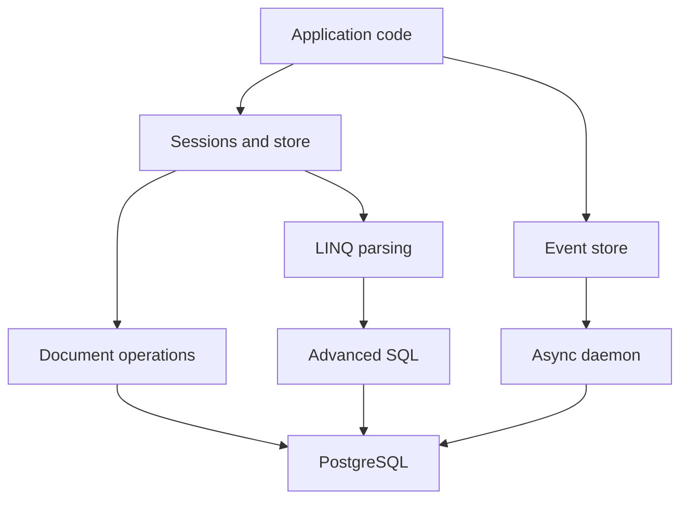

# JasperFx/marten

> .NET library that turns PostgreSQL into a document database and a transactional event log.

## The problem
.NET developers want a document database and event sourcing without leaving PostgreSQL or adding a second engine.

## What it actually does
It stores JSON documents in PostgreSQL through sessions, with LINQ queries, compiled queries and native partial updates. It also provides an ACID event store, projections and an asynchronous daemon. Multi-tenancy and subscriptions are mentioned; the sampled code does not show all of their wiring.

## How it is wired


## Trying it
```bash
./build.sh compile
docker compose up -d
./build.sh test
```
These commands are for developing Marten itself; application-side installation points to martendb.io.

## Cost and gotchas
PostgreSQL 13 minimum, .NET 9 or 10. Docker recommended for tests. Node 22+ only for the docs site.

## What it is not
Not a relational ORM nor a standalone engine: everything relies on PostgreSQL. The README mostly describes working on the code, not usage.

## Alternatives
No alternative named in the README.

## For you
Worth watching: solid if you are on .NET with PostgreSQL, of no direct interest for a Python data/AI profile.
