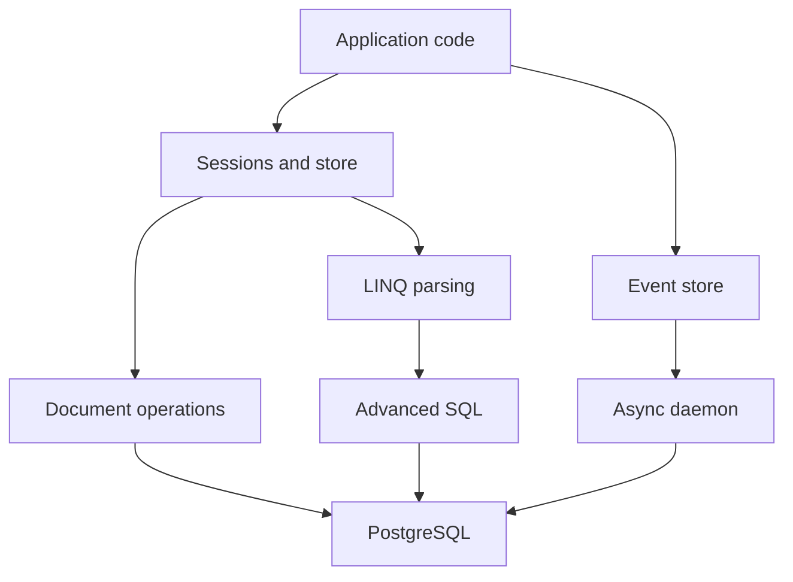

# JasperFx/marten

> Bibliothèque .NET qui transforme PostgreSQL en base documentaire et en journal d'événements transactionnel.

## Le problème
Les développeurs .NET veulent une base documentaire et de l'event sourcing, sans quitter PostgreSQL ni ajouter un second moteur.

## Ce que ça fait vraiment
Elle stocke des documents JSON dans PostgreSQL via des sessions, avec requêtes LINQ, requêtes compilées et mises à jour partielles natives. Elle fournit aussi un magasin d'événements ACID, des projections et un démon asynchrone. Multi-tenance et abonnements sont mentionnés ; le code échantillonné ne montre pas tout leur câblage.

## Comment c'est branché


## Essayer
```bash
./build.sh compile
docker compose up -d
./build.sh test
```
Ces commandes servent à développer Marten lui-même ; l'installation côté application renvoie à martendb.io.

## Coût et pièges
PostgreSQL 13 minimum, .NET 9 ou 10. Docker recommandé pour les tests. Node 22+ seulement pour le site de doc.

## Ce que ce n'est pas
Pas un ORM relationnel ni un moteur autonome : tout repose sur PostgreSQL. Le README décrit surtout le travail sur le code, pas l'usage.

## Alternatives
Aucune alternative nommée dans le README.

## Pour toi
À surveiller : solide si tu es en .NET sur PostgreSQL, sans intérêt direct pour un profil Python data/IA.

