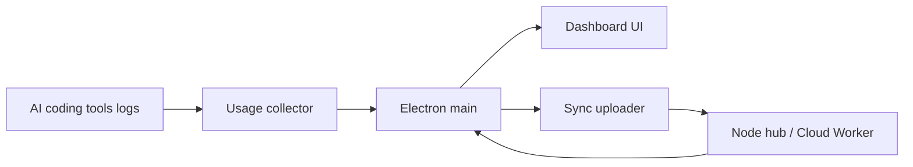

# Javis603/token-monitor

> Desktop widget showing token usage and limits of more than 37 AI coding tools, across devices.

## The problem
Token usage and quotas are scattered across tools (Claude Code, Codex, Cursor, Copilot…) and machines.

## What it actually does
An Electron application reads the tools' logs locally (via tokscale) and displays costs, tokens, cache rates, per-provider limits, trends and a yearly activity map. Optional multi-device synchronization goes through a hub (in the widget, in Node or on a Cloudflare Worker), with Server-Sent Events. Menu bar items, macOS widgets, CSV/JSON export, multiple accounts.

## How it is wired


## Trying it
```bash
brew install --cask token-monitor
```
Or build: `npm install` then `npm run dist:linux`. Node hub: `cp .env.example .env` then `npm run hub`.

## Cost and gotchas
Free. Local mode by default with no configuration. Reading the limits requires provider credentials. Claude Code only keeps 30 days of transcripts by default; the retention option is provided.

## What it is not
Not a token optimizer: it only measures. The README states no telemetry to the maintainer; the network is only used for the features that are enabled.

## Alternatives
- tokscale and CodexBar: cited as analysis building blocks and inspiration.

## For you
Adopt if you juggle several AI coding tools: a single view of cost and quotas, with data staying local.
