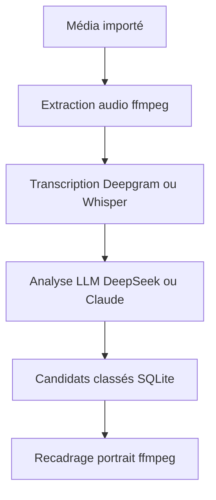

# JayWebtech/autoshorts

> Desktop application that cuts long videos into vertical 9:16 clips ranked by viral potential by an LLM.

## The problem
Manually spotting the best moments of a long video to make shorts takes hours.

## What it actually does
Tauri 2, React and Rust with SQLite. The pipeline imports the media, extracts the audio, transcribes it with Deepgram or local Whisper, then asks DeepSeek (default), Claude or an Ollama model to find and rank the highlights. `ffmpeg` center-crops to portrait H.264. Transcripts, candidates and projects stay in the local SQLite database.

## How it is wired
Simplified diagram based on the sheet, no diagram provided.



## Trying it
```bash
cp .env.example .env
npm install
npm run tauri:dev
npm run tauri:build
```

## Cost and gotchas
FFmpeg and FFprobe on the PATH. Deepgram and DeepSeek or Claude keys at your expense (the README estimates under a thousandth of a dollar per transcription with DeepSeek). Unsigned binaries: Gatekeeper or SmartScreen workaround needed.

## What it is not
Not a reliably fully local tool: the README advises against small Ollama models for moment detection. No license declared, so no right to reuse.

## Alternatives
No alternative named in the README.

## For you
Keep an eye on it: a concrete example of a transcription plus LLM pipeline, instructive, but unlicensed and young, so do not reuse as is.
