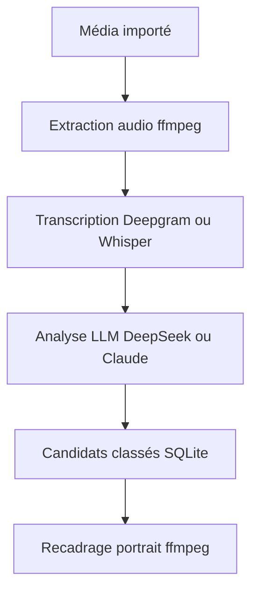

# JayWebtech/autoshorts

> Application de bureau qui découpe de longues vidéos en clips verticaux 9:16 classés par potentiel viral par un LLM.

## Le problème
Repérer à la main les meilleurs moments d'une longue vidéo pour en tirer des shorts prend des heures.

## Ce que ça fait vraiment
Tauri 2, React et Rust avec SQLite. Le pipeline importe le média, extrait l'audio, le transcrit avec Deepgram ou Whisper local, puis demande à DeepSeek (par défaut), Claude ou un modèle Ollama de repérer et classer les moments forts. `ffmpeg` recadre au centre en portrait H.264. Transcriptions, candidats et projets restent dans la base SQLite locale.

## Comment c'est branché
Schéma simplifié d'après la fiche, sans diagramme fourni.



## Essayer
```bash
cp .env.example .env
npm install
npm run tauri:dev
npm run tauri:build
```

## Coût et pièges
FFmpeg et FFprobe sur le PATH. Clés Deepgram et DeepSeek ou Claude à ta charge (le README estime moins d'un millième de dollar par transcription avec DeepSeek). Binaires non signés : contournement de Gatekeeper ou SmartScreen.

## Ce que ce n'est pas
Pas un outil entièrement local fiable : le README déconseille les petits modèles Ollama pour la détection de moments. Aucune licence déclarée, donc aucun droit de réutilisation.

## Alternatives
Aucune alternative nommée dans le README.

## Pour toi
À surveiller : exemple concret de pipeline transcription plus LLM, instructif, mais sans licence et jeune, donc à ne pas réutiliser tel quel.

