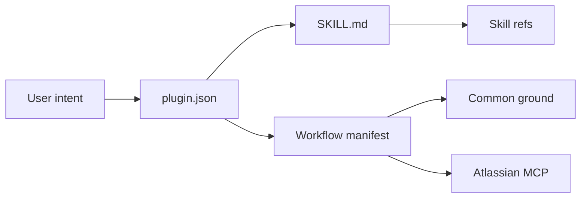

# Jeffallan/claude-skills

> Claude Code plugin bundling 67 development skills and project workflow commands.

## The problem
Claude Code lacks framework-specific guides and reproducible project processes, which have to be rewritten for every repository.

## What it actually does
67 skills in 12 categories (languages, frameworks, infra, testing, DevOps, security, data/ML), each a `SKILL.md` plus references loaded on demand.
Suggested chains (e.g. Feature Forge → Architecture Designer → Test Master).
9 workflow commands (intake, discovery, planning, execution, retrospective) linked to Jira/Confluence.
`/common-ground` to make Claude spell out its assumptions about your project.

## How it is wired


## Trying it
```bash
/plugin marketplace add jeffallan/claude-skills
/plugin install fullstack-dev-skills@jeffallan
```

## Cost and gotchas
Free; the workflow commands require an Atlassian MCP server (Jira/Confluence).
Loading many skills can pollute the context.

## What it is not
Not executable code: it is written knowledge, and its quality depends on each file.
Not an official Anthropic product.

## Alternatives
No alternative named in the README.

## For you
Worth watching: pick skill by skill (notably data/ML) rather than installing everything, and useful as a model for organizing your own skills.
