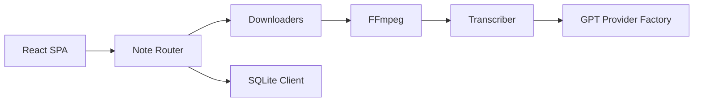

# JefferyHcool/BiliNote

> Open-source assistant that turns videos (Bilibili, YouTube...) into Markdown notes.

## The problem
Taking structured notes on a long video takes as long as watching it.

## What it actually does
It downloads the video (Bilibili, YouTube, Douyin, Kuaishou, local file) or fetches the subtitles.
Local transcription (Faster-Whisper, MLX-Whisper) or remote (Groq, BCut), then an LLM summary in Markdown.
Screenshots, timestamped links back to the video, RAG question answering on the note.
FastAPI + SQLite backend, React front end, browser extension, Tauri desktop client.

## How it is wired


## Trying it
```bash
docker pull ghcr.io/jefferyhcool/bilinote:latest
docker run -d -p 80:80 -v bilinote-data:/app/backend/data --name bilinote ghcr.io/jefferyhcool/bilinote:latest
```

## Cost and gotchas
LLM key at your expense; GPU optional for Whisper. The Whisper model can cause an OOM on first launch (hence `tiny` by default).

## What it is not
Not only open source: a hosted Pro version and paid services are promoted. PDF, Word or Notion export does not exist yet.

## Alternatives
No alternative is named in the README.

## For you
Worth watching: the video → transcription → LLM → RAG pipeline is a good reference model, close to your `watch-md` skill.
