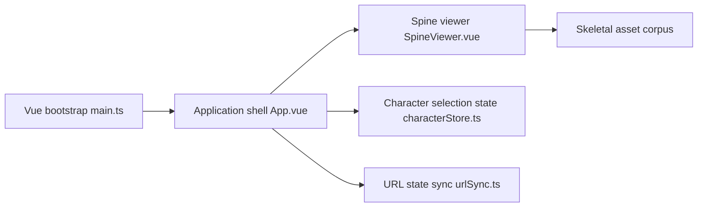

# Jelosus2/BD2-L2D-Viewer

> Static site for viewing the character animations of the game Brown Dust 2.

## The problem
Not documented in the README: only the site's purpose is visible.

## What it actually does
The README is only a few lines long. Based on the code architecture: Vue/TypeScript application with Vite, Spine player for the animations, character and animation selectors, settings, state synchronized with the URL, local import of resources and backgrounds, built-in voices. Deployed as GitHub static pages, with no server.

## How it is wired

## Trying it
No command documented in the README.

## Cost and gotchas
Not documented. The game's resources are embedded in the repository; the question of rights is not addressed.

## What it is not
Not documented: insufficient README (under 800 characters), the elements above come from the code architecture.

## Alternatives
No alternative named in the README.

## For you
Ignore: insufficient material and a game character viewer unrelated to data or AI.
