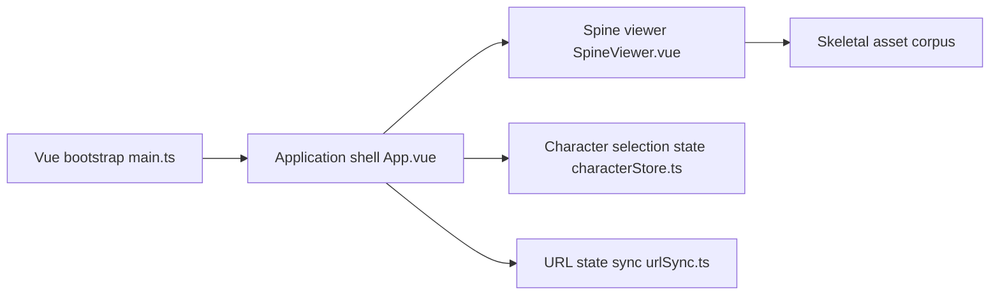

# Jelosus2/BD2-L2D-Viewer

> Site statique pour visionner les animations des personnages du jeu Brown Dust 2.

## Le problème
Non documenté dans le README : on voit seulement l'objet du site.

## Ce que ça fait vraiment
Le README ne tient qu'en quelques lignes. D'après l'architecture du code : application Vue/TypeScript avec Vite, lecteur Spine pour les animations, sélecteurs de personnages et d'animations, réglages, état synchronisé avec l'URL, import local de ressources et d'arrière-plans, voix intégrées. Déployé en pages statiques GitHub, sans serveur.

## Comment c'est branché

## Essayer
Aucune commande documentée dans le README.

## Coût et pièges
Non documenté. Les ressources du jeu sont embarquées dans le dépôt ; la question des droits n'est pas abordée.

## Ce que ce n'est pas
Pas documenté : README insuffisant (moins de 800 caractères), les éléments ci-dessus viennent de l'architecture du code.

## Alternatives
Aucune alternative nommée dans le README.

## Pour toi
À ignorer : matière insuffisante et visionneuse de personnages de jeu sans lien avec la data ou l'IA.

