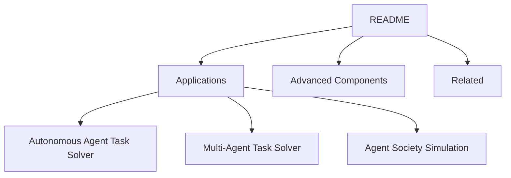

# Jenqyang/Awesome-AI-Agents

> Annotated list of open-source LLM agent projects, ranked by use, for anyone doing watch work.

## The problem
LLM agents come out every week, with no ranking or sorting. Without a list, you have to spot everything by hand.

## What it actually does
It is a structured README: autonomous agent applications, multi-agent, society simulation, advanced components, tools, frameworks, benchmarks, platforms, then related resources (surveys, blogs). Each entry fits in a one-line description. The README provided is truncated in the simulation section: the end was not read.

## How it is wired
Simplified diagram based on the sheet, no diagram provided.



## Trying it
```bash
# Aucune commande documentée : ouvrir le README, ou le site cherchable indiqué ("Browse the searchable website").
```

## Cost and gotchas
Free, nothing to install. Entries are declarative: many very recent projects, whose maturity is not verified by the list.

## What it is not
It is not an evaluated comparison: no rating or quality criterion. It is not a tool. The license is absent: the content is not explicitly reusable.

## Alternatives
No alternative named in the README that was read.

## For you
Worth watching: useful as a map of the agentic landscape and for spotting tools to add to the catalog, but with no quality sorting and no license.
