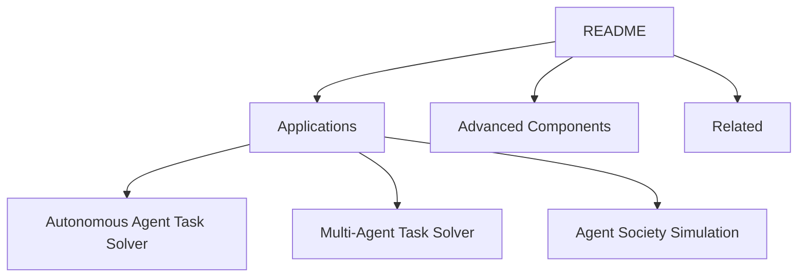

# Jenqyang/Awesome-AI-Agents

> Liste commentée de projets d'agents LLM open source, classés par usage, pour qui fait de la veille.

## Le problème
Les agents LLM sortent chaque semaine, sans classement ni tri. Sans liste, il faut tout repérer à la main.

## Ce que ça fait vraiment
C'est un README structuré : applications d'agents autonomes, multi-agents, simulation de société, composants avancés, outils, frameworks, benchmarks, plateformes, puis ressources liées (surveys, blogs). Chaque entrée tient en une ligne de description. Le README fourni est tronqué dans la section simulation : la fin n'a pas été lue.

## Comment c'est branché
Schéma simplifié d'après la fiche, sans diagramme fourni.



## Essayer
```bash
# Aucune commande documentée : ouvrir le README, ou le site cherchable indiqué ("Browse the searchable website").
```

## Coût et pièges
Gratuit, rien à installer. Les entrées sont déclaratives : beaucoup de projets très récents, dont la maturité n'est pas vérifiée par la liste.

## Ce que ce n'est pas
Ce n'est pas un comparatif évalué : aucune note ni critère de qualité. Ce n'est pas un outil. La licence est absente : le contenu n'est pas explicitement réutilisable.

## Alternatives
Aucune alternative nommée dans le README lu.

## Pour toi
Surveiller : utile comme carte du paysage agentique et pour repérer des outils à verser au catalogue, mais sans tri de qualité ni licence.

