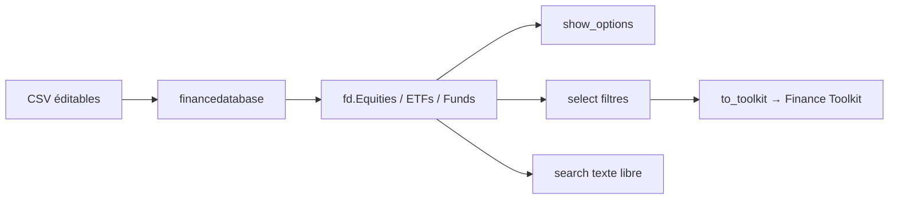

# JerBouma/FinanceDatabase

> Database of 300,000+ categorized financial symbols, queryable from Python.

## The problem
Finding which instruments exist in a sector, a country or an industry is impossible without a catalog: you only know the tickers that are already famous.

## What it actually does
Provides 112,707 equities, 36,481 ETFs, 57,853 funds, 2,556 currencies, 3,367 cryptos, 91,181 indices, 1,367 money markets.
`select()` filters by country, sector, industry, exchange, market; `show_options()` lists the possible values without loading the large files.
`search()` looks for a string in any column, including the summary, with or without case sensitivity.
`to_toolkit()` switches a selection over to the Finance Toolkit for financial analysis.

## How it is wired


## Trying it
```python
import financedatabase as fd
equities = fd.Equities()
equities.select(country='Netherlands', industry='Insurance')
fd.show_options("equities")
```

## Cost and gotchas
The database itself is free. `to_toolkit()` requires a FinancialModelingPrep API key, at your expense. Each asset class loads once: keep the object in a variable, otherwise every query reloads everything.

## What it is not
Explicitly not a source of fundamentals or prices: only the categorization of products. The data comes from CSVs maintained by hand by the community, so dated and improvable. The same issuer appears several times, once per listing venue, unless `only_primary_listing` or a market filter is used.

## Alternatives
Finance Toolkit — cited in the README as the complement that provides the financial data this database does not cover.

## For you
Useful as a starting reference for a finance pipeline; treat it as catalog data, not as market truth.
