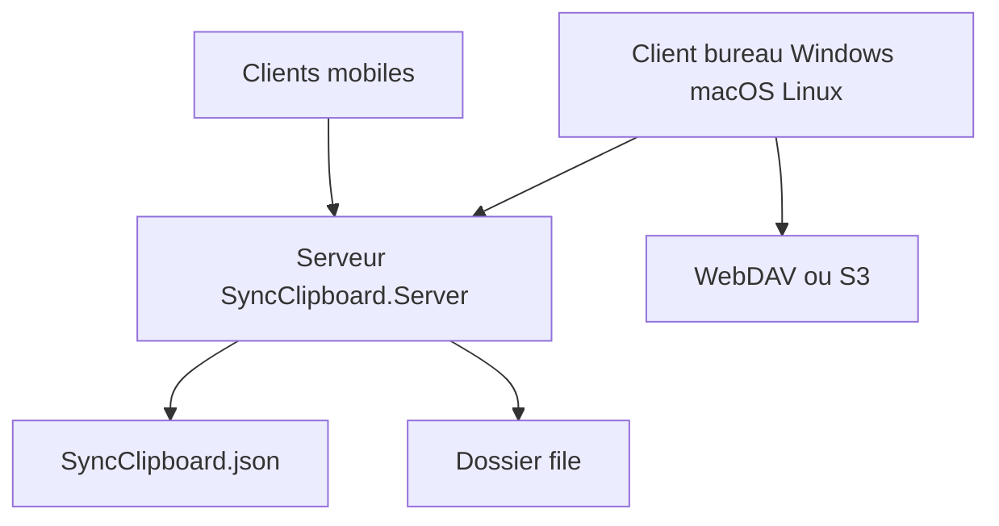

# Jeric-X/SyncClipboard

> Syncs the clipboard between Windows, macOS, Linux and mobile devices via a server, WebDAV or S3.

## The problem
Copying text, an image or a file on one device and pasting it on another requires manual steps.

## What it actually does
The desktop clients run in the background and sync text, images and files, with a history. The server can be standalone (ASP.NET Core 10, Docker), built into the client, or replaced by WebDAV (Nextcloud, AList) or S3. A simple API exchanges a `SyncClipboard.json` file with a hash. Community mobile clients are listed.

## How it is wired
Simplified diagram based on the sheet, no diagram provided.



## Trying it
```bash
winget install --id JericX.SyncClipboard --exact --source winget
docker run -d --name=syncclipboard-server -p 5033:5033 -e SYNCCLIPBOARD_USERNAME=your_username -e SYNCCLIPBOARD_PASSWORD=your_password jericx/syncclipboard-server:latest
```

## Cost and gotchas
Free, MIT. HTTP is in clear text: the README asks for HTTPS or a reverse proxy on a public network. The history is described as early-stage, with a risk of loss. Version 3.1.1 breaks compatibility with earlier ones.

## What it is not
It is not a password manager or a backup. The README warns against keeping important information only there.

## Alternatives
No alternative named in the README.

## For you
Ignore: personal convenience unrelated to data/AI/MLOps, and the copied data passes through a server you must secure.
