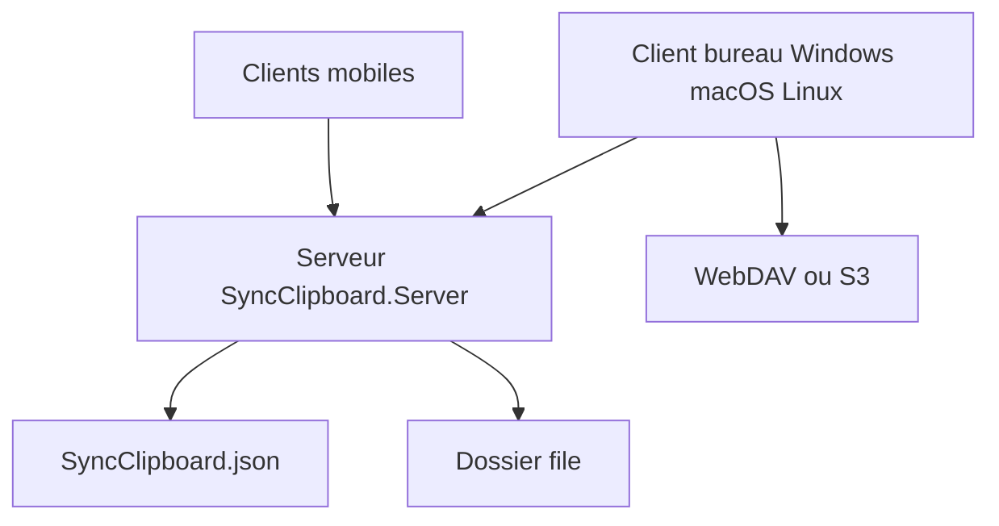

# Jeric-X/SyncClipboard

> Synchronise le presse-papiers entre Windows, macOS, Linux et mobiles via serveur, WebDAV ou S3.

## Le problème
Copier du texte, une image ou un fichier sur un appareil et le coller sur un autre demande des étapes manuelles.

## Ce que ça fait vraiment
Les clients de bureau tournent en arrière-plan et synchronisent texte, images et fichiers, avec un historique. Le serveur peut être autonome (ASP.NET Core 10, Docker), intégré au client, ou remplacé par WebDAV (Nextcloud, AList) ou S3. Une API simple échange un fichier `SyncClipboard.json` avec hachage. Clients mobiles communautaires listés.

## Comment c'est branché
Schéma simplifié d'après la fiche, sans diagramme fourni.



## Essayer
```bash
winget install --id JericX.SyncClipboard --exact --source winget
docker run -d --name=syncclipboard-server -p 5033:5033 -e SYNCCLIPBOARD_USERNAME=your_username -e SYNCCLIPBOARD_PASSWORD=your_password jericx/syncclipboard-server:latest
```

## Coût et pièges
Gratuit, MIT. Le HTTP est en clair : le README demande HTTPS ou un proxy inverse en réseau public. L'historique est qualifié de précoce, avec risque de perte. La version 3.1.1 casse la compatibilité avec les précédentes.

## Ce que ce n'est pas
Ce n'est pas un gestionnaire de mots de passe ni une sauvegarde. Le README prévient de ne pas y garder d'informations importantes uniquement.

## Alternatives
Aucune alternative nommée dans le README.

## Pour toi
À ignorer : confort personnel sans lien avec data/IA/MLOps, et les données copiées transitent par un serveur à sécuriser.

