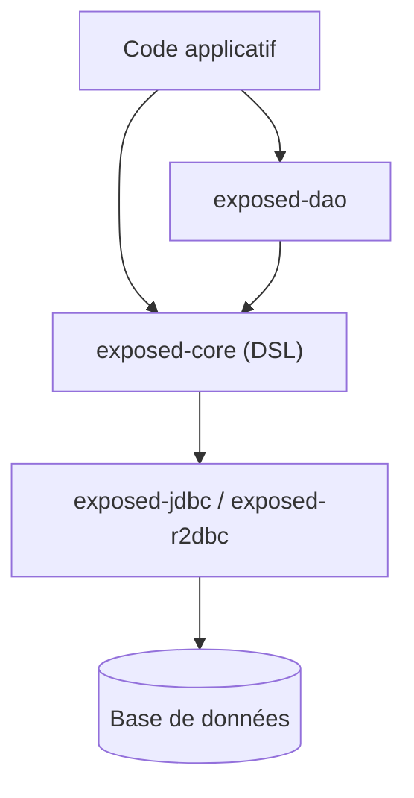

# JetBrains/Exposed

> Lightweight ORM for Kotlin, with a typed DSL and a DAO API, on JDBC or R2DBC.

## The problem
Writing SQL by hand in Kotlin is verbose and unsafe, and switching database engines is painful.

## What it actually does
Two approaches: a typed SQL DSL (tables, insert, select, joins, group by) and a DAO API (entities, relations). Modules: core, JDBC, R2DBC (R2DBC DAO is experimental), JSON, dates (java-time, kotlinx-datetime), migrations, crypto, Spring Boot 3 and 4 starters. Kotlin 2.2+ required; JDK 8 to 17 depending on the module.

## How it is wired


## Trying it
```kotlin
Database.connect("jdbc:h2:mem:test", driver = "org.h2.Driver", user = "root", password = "")
transaction {
    SchemaUtils.create(Cities, Users)
}
```
Maven Central dependencies: see the modules guide.

## Cost and gotchas
Free. Version 1.0: imports have changed (`org.jetbrains.exposed.v1`), read the migration guide.

## What it is not
Not a Python or pure-Java ORM: designed for Kotlin. R2DBC DAO is still experimental.

## Alternatives
No alternative named in the README.

## For you
Ignore: Kotlin library for JVM backends, only useful if your data stack runs on Kotlin or Spring.
