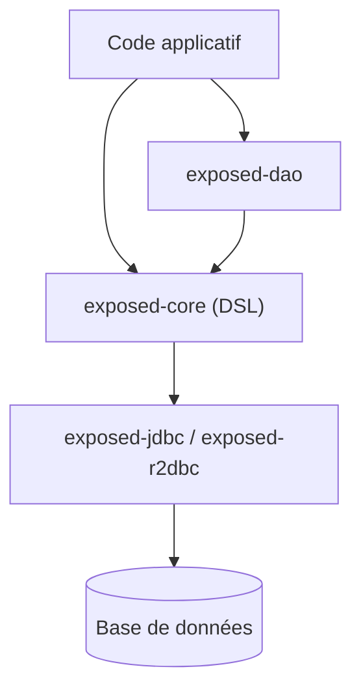

# JetBrains/Exposed

> ORM léger pour Kotlin, avec DSL typé et API DAO, sur JDBC ou R2DBC.

## Le problème
Écrire du SQL à la main en Kotlin est verbeux et peu sûr, et changer de moteur est pénible.

## Ce que ça fait vraiment
Deux approches : un DSL SQL typé (tables, insert, select, jointures, group by) et une API DAO (entités, relations). Modules cœur, JDBC, R2DBC (DAO R2DBC expérimental), JSON, dates (java-time, kotlinx-datetime), migrations, crypto, starters Spring Boot 3 et 4. Kotlin 2.2+ requis ; JDK 8 à 17 selon le module.

## Comment c'est branché


## Essayer
```kotlin
Database.connect("jdbc:h2:mem:test", driver = "org.h2.Driver", user = "root", password = "")
transaction {
    SchemaUtils.create(Cities, Users)
}
```
Dépendances Maven Central : voir le guide des modules.

## Coût et pièges
Gratuit. Version 1.0 : les imports ont changé (`org.jetbrains.exposed.v1`), guide de migration à lire.

## Ce que ce n'est pas
Pas un ORM Python ni Java pur : pensé pour Kotlin. DAO R2DBC encore expérimental.

## Alternatives
Aucune alternative nommée dans le README.

## Pour toi
Ignorer : bibliothèque Kotlin pour backend JVM, utile seulement si ton stack data tourne sur Kotlin ou Spring.

