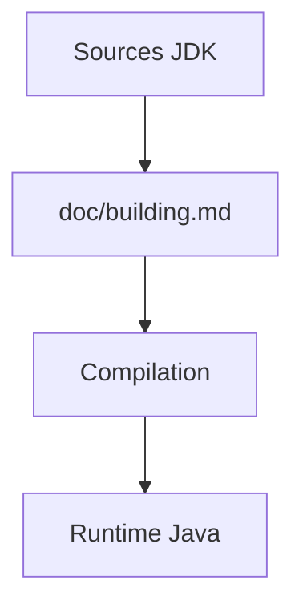

# JetBrains/JetBrainsRuntime

> OpenJDK fork maintained by JetBrains to run its IDEs.

## The problem
The README does not say: it reuses the standard OpenJDK text.

## What it actually does
Not documented in the README, which only points to the build documentation (doc/building.md) and to the OpenJDK community. The name indicates a Java runtime based on the JDK.

## How it is wired
Simplified diagram based on the fiche, no diagram provided.


## Trying it
```bash
# Aucune commande documentée : voir doc/building.html ou doc/building.md.
```

## Cost and gotchas
Building a JDK requires a heavy build chain and time. GPL-2.0 license.

## What it is not
Not a product to install directly from this README.

## Alternatives
No alternative named in the README.

## For you
Ignore: an IDE Java runtime, of no interest for your data/AI work.
