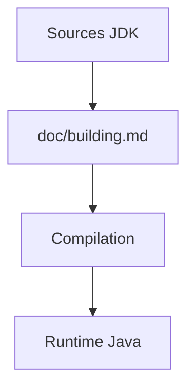

# JetBrains/JetBrainsRuntime

> Fork d'OpenJDK maintenu par JetBrains pour faire tourner ses IDE.

## Le problème
Le README ne le dit pas : il reprend le texte standard d'OpenJDK.

## Ce que ça fait vraiment
Non documenté dans le README, qui renvoie seulement à la documentation de compilation (doc/building.md) et à la communauté OpenJDK. Le nom indique un runtime Java basé sur le JDK.

## Comment c'est branché
Schéma simplifié d'après la fiche, sans diagramme fourni.


## Essayer
```bash
# Aucune commande documentée : voir doc/building.html ou doc/building.md.
```

## Coût et pièges
Compiler un JDK demande une chaîne de build lourde et du temps. Licence GPL-2.0.

## Ce que ce n'est pas
Pas un produit à installer directement depuis ce README.

## Alternatives
Aucune alternative nommée dans le README.

## Pour toi
Ignorer : un runtime Java d'IDE, sans intérêt pour ton travail data/IA.

