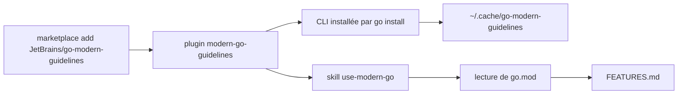

# JetBrains/go-modern-guidelines

> Guidelines that push a coding agent to write modern Go rather than dated Go.

## The problem
Agents generate Go from five years ago: manual loops, chains of nil checks, `for i := 0`.
Two causes: the training data cutoff and frequency bias.

## What it actually does
Provides an explicit reference of the features of Go 1.0 to 1.27, including everything targeted by the `modernize` analyzer.
The agent detects the project's version in `go.mod` and only uses what is available up to that version.
Expected result: `max(a, b)`, `slices.Contains`, `cmp.Or(a, b, c)`, `new(42)`, `errors.AsType[T]`.
`FEATURES.md` carries the full list with descriptions and examples.

## How it is wired


## Trying it
```
/plugin marketplace add JetBrains/go-modern-guidelines
/plugin install modern-go-guidelines@goland-claude-marketplace
```

## Cost and gotchas
Free, but the Go toolchain must be installed and in the `PATH`: the CLI is installed with `go install`.
It targets Go 1.25 or newer; on older versions it relies on the automatic switch `GOTOOLCHAIN=auto`.

## What it is not
Not a linter: it guides writing, it does not fix existing code — that is the role of `modernize`.
Not a tool outside an agent: without a coding agent, its value is that of a document to read.
Not neutral to install: it downloads and runs a binary from its cache.

## Alternatives
The Go team's `modernize` analyzer, for updating code already written.

## For you
Irrelevant if you do not write Go; the "versioned guidelines for an agent" model, however, is worth borrowing.
