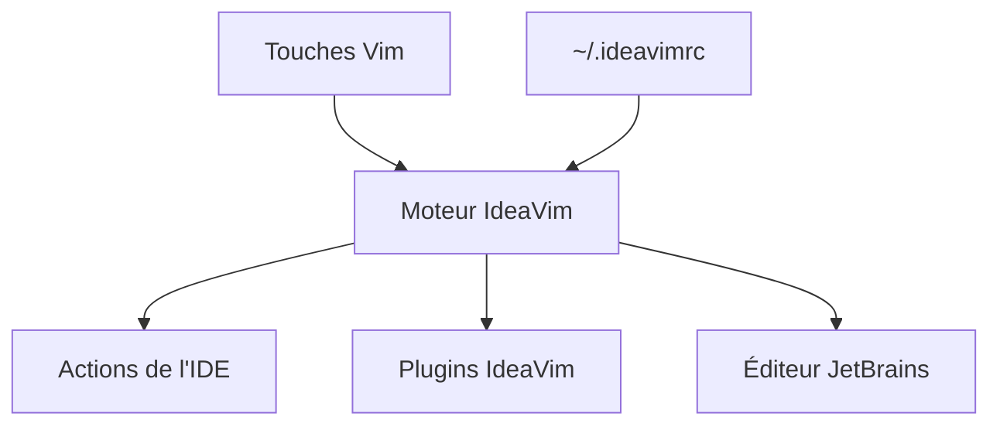

# JetBrains/ideavim

> Vim engine built into JetBrains IDEs (PyCharm, IntelliJ, DataSpell...), for those who edit by keyboard.

## The problem
Losing your Vim reflexes when moving to a JetBrains IDE, or having to juggle between the two tools.

## What it actually does
Emulates Vim modes, motions, macros, registers and searches. Reads a ~/.ideavimrc file, runs Vim script, and triggers any IDE action through mappings (Action). A small set of plugins (surround, commentary, easymotion) is reproduced.

## How it is wired
Simplified diagram based on the sheet, no diagram provided.



## Trying it
Install via Settings | Plugins in the IDE, then Tools | Vim to enable or disable. Configuration in ~/.ideavimrc; the README gives for example:
```bash
source ~/.vimrc
```
(command to put in ~/.ideavimrc to reuse your Vim configuration).

## Cost and gotchas
Free. EAP builds may be of lower quality than a beta. Shortcut conflicts with the IDE keymap must be resolved by hand.

## What it is not
Not a full Vim: not all Vim script functions and options are supported. Does not work outside JetBrains IDEs.

## Alternatives
No alternative named in the README (Neovim only appears in a configuration example).

## For you
Adopt if you code your notebooks and pipelines in PyCharm or DataSpell in Vim mode: free, maintained by the IDE's vendor.
