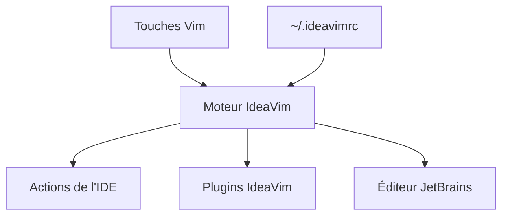

# JetBrains/ideavim

> Moteur Vim intégré aux IDE JetBrains (PyCharm, IntelliJ, DataSpell...), pour qui édite au clavier.

## Le problème
Perdre ses réflexes Vim en passant dans un IDE JetBrains, ou devoir jongler entre les deux outils.

## Ce que ça fait vraiment
Émule les modes, mouvements, macros, registres et recherches Vim. Lit un fichier ~/.ideavimrc, exécute du Vim script, et déclenche n'importe quelle action de l'IDE via des mappings (Action). Un petit jeu de plugins (surround, commentary, easymotion) est reproduit.

## Comment c'est branché
Schéma simplifié d'après la fiche, sans diagramme fourni.



## Essayer
Installation via Settings | Plugins dans l'IDE, puis Tools | Vim pour activer ou désactiver. Configuration dans ~/.ideavimrc ; le README donne par exemple :
```bash
source ~/.vimrc
```
(commande à placer dans ~/.ideavimrc pour reprendre sa configuration Vim).

## Coût et pièges
Gratuit. Les builds EAP peuvent être de qualité inférieure à une bêta. Des conflits de raccourcis avec le keymap de l'IDE sont à régler à la main.

## Ce que ce n'est pas
Pas un Vim complet : toutes les fonctions et options Vim script ne sont pas supportées. Ne fonctionne pas hors des IDE JetBrains.

## Alternatives
Aucune alternative nommée dans le README (Neovim n'apparaît que dans un exemple de configuration).

## Pour toi
À adopter si tu codes tes notebooks et pipelines dans PyCharm ou DataSpell en mode Vim : gratuit, maintenu par l'éditeur de l'IDE.

