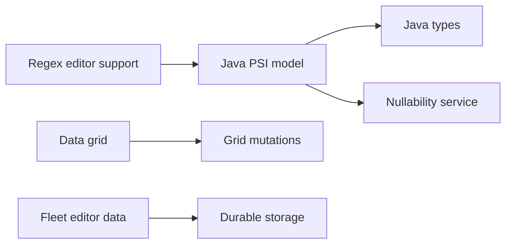

# JetBrains/intellij-community

> Open source code of the JetBrains IDEs, the base of the IntelliJ platform, for contributors and plugin authors.

## The problem
Building or extending a JetBrains IDE requires access to its code and its build system.

## What it actually does
Repository of the community edition of IntelliJ IDEA and PyCharm: Java services (PSI), regex, data grid, images, dependency resolution, Fleet editor data. Migration to Bazel in progress; `installers.cmd` and `tests.cmd` scripts, Docker build environment.

## How it is wired


## Trying it
```bash
git clone https://github.com/JetBrains/intellij-community.git
./getPlugins.sh
./bazel.cmd run //build:idea_community
```

## Cost and gotchas
IntelliJ IDEA 2026.1+ with the Bazel plugin; large clone (shallow clone possible); Android modules to fetch; some tests do not run under Bazel yet.

## What it is not
Not a product to install: the IDE is downloaded elsewhere. A license is present but not identified by GitHub.

## Alternatives
None named in the README.

## For you
Ignore: reserved for those who develop plugins or contribute to the IDE; just use PyCharm.
