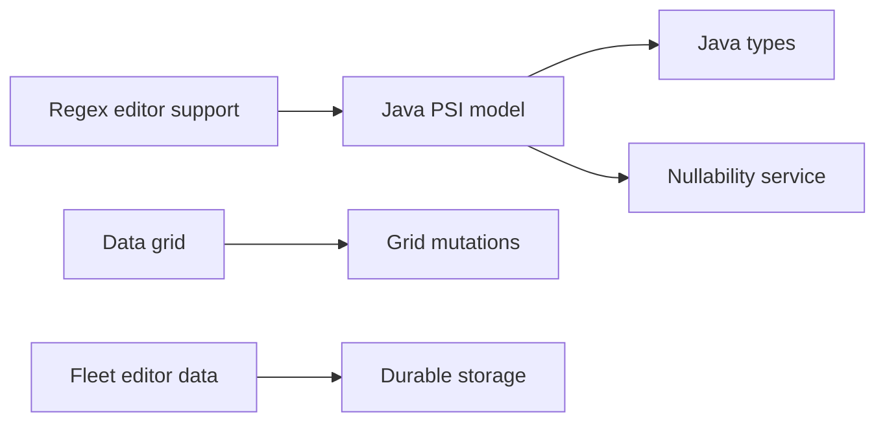

# JetBrains/intellij-community

> Code source ouvert des IDE JetBrains, base de la plateforme IntelliJ, pour contributeurs et auteurs de plugins.

## Le problème
Construire ou étendre un IDE JetBrains exige d'accéder à son code et à son système de build.

## Ce que ça fait vraiment
Dépôt de l'édition communautaire d'IntelliJ IDEA et PyCharm : services Java (PSI), regex, grille de données, images, résolution de dépendances, données d'éditeur de Fleet. Migration en cours vers Bazel ; scripts `installers.cmd` et `tests.cmd`, environnement de build Docker.

## Comment c'est branché


## Essayer
```bash
git clone https://github.com/JetBrains/intellij-community.git
./getPlugins.sh
./bazel.cmd run //build:idea_community
```

## Coût et pièges
IntelliJ IDEA 2026.1+ avec plugin Bazel ; clone volumineux (clone superficiel possible) ; modules Android à récupérer ; certains tests ne tournent pas encore sous Bazel.

## Ce que ce n'est pas
Pas un produit à installer : l'IDE se télécharge ailleurs. Licence présente mais non identifiée par GitHub.

## Alternatives
Aucune nommée dans le README.

## Pour toi
Ignorer : réservé à qui développe des plugins ou contribue à l'IDE ; utilise simplement PyCharm.

