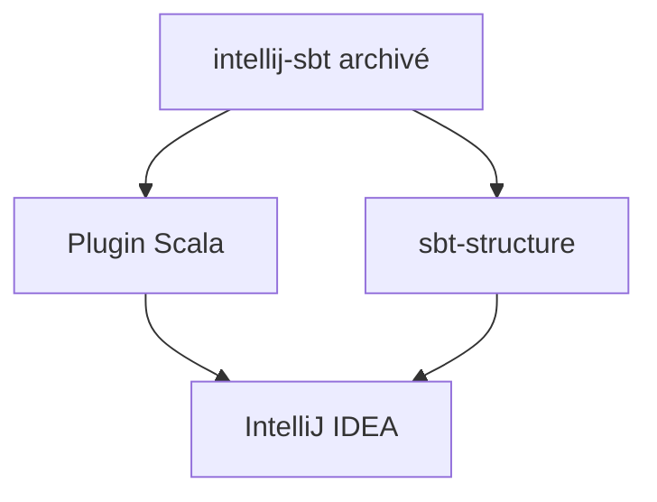

# JetBrains/intellij-sbt

> Former IntelliJ IDEA plugin for sbt, abandoned and split into two repositories.

## The problem
Opening and importing an sbt project in IntelliJ IDEA.

## What it actually does
Alpha: sbt project import, automatic reimport and support for .sbt files. The console, the command window and the build remain to be done. The repository is split between the sbt-structure plugin and the Scala plugin.

## How it is wired
Simplified diagram based on the sheet, no diagram provided.



## Trying it
```bash
# Aucune commande documentée
```

## Cost and gotchas
Last push in 2017, repository archived, no license.

## What it is not
Not the current plugin: sbt support now lives in the Scala plugin.

## Alternatives
- sbt-structure: sbt plugin that came out of the split.
- Scala plugin: contains the IDE-specific part.

## For you
Ignore: archived for years and reserved for Scala.
