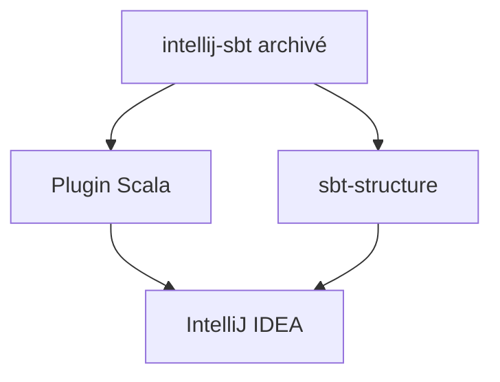

# JetBrains/intellij-sbt

> Ancien plugin IntelliJ IDEA pour sbt, abandonné et scindé en deux dépôts.

## Le problème
Ouvrir et importer un projet sbt dans IntelliJ IDEA.

## Ce que ça fait vraiment
Alpha : import de projet sbt, réimport automatique et support des fichiers .sbt. La console, la fenêtre de commandes et la construction restent à faire. Le dépôt est scindé entre le plugin sbt-structure et le plugin Scala.

## Comment c'est branché
Schéma simplifié d'après la fiche, sans diagramme fourni.



## Essayer
```bash
# Aucune commande documentée
```

## Coût et pièges
Dernier push en 2017, dépôt archivé, aucune licence.

## Ce que ce n'est pas
Pas le plugin actuel : le support sbt vit désormais dans le plugin Scala.

## Alternatives
- sbt-structure : plugin sbt issu de la scission.
- Plugin Scala : contient la partie spécifique à l'IDE.

## Pour toi
Ignorer : archivé depuis des années et réservé à Scala.

