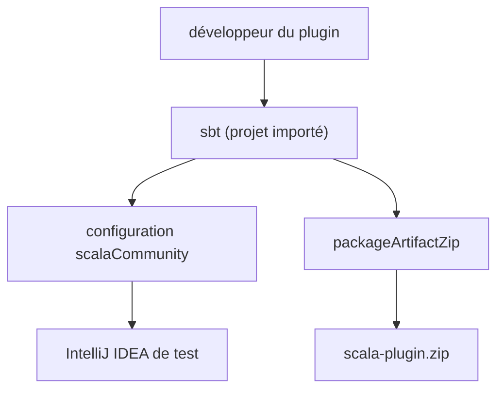

# JetBrains/intellij-scala

> Scala plugin for IntelliJ IDEA: completion, navigation, debugger, sbt, Maven and Gradle integration.

## The problem
Writing Scala without a suitable editor (types, implicits, refactorings) is painful.

## What it actually does
The repository README is aimed mostly at contributors: highlighting, inspections, navigation, sbt, Maven, Gradle and BSP support, test frameworks (ScalaTest, MUnit, Specs2, uTest), debugger and worksheets. It explains how to run the plugin from source, package it, run the tests (the fast tests can take over an hour) and deal with common problems.

## How it is wired

Simplified diagram based on the sheet, no diagram was provided.

## Trying it
```bash
git clone https://github.com/JetBrains/intellij-scala.git
# puis, dans le shell sbt :
packageArtifactZip
runFastTests
```

## Cost and gotchas
Free. To develop: IntelliJ IDEA 2022.3+, JDK 25, plenty of memory and patience for the tests. The GitHub repository is a mirror of the Community version.

## What it is not
Not the plugin to install as is: end users go through the JetBrains Marketplace.

## Alternatives
No alternative named in the README.

## For you
Worth watching: only if you write Scala (Spark) in IntelliJ; the plugin is installed through the Marketplace, not through this repository.
