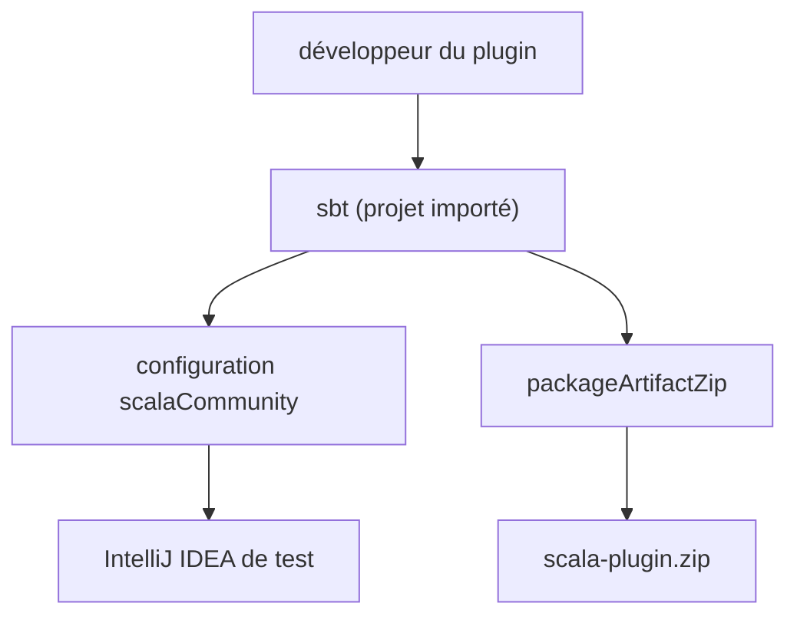

# JetBrains/intellij-scala

> Plugin Scala pour IntelliJ IDEA : complétion, navigation, débogueur, intégration sbt, Maven, Gradle.

## Le problème
Écrire du Scala sans éditeur adapté (types, implicites, refactorings) est pénible.

## Ce que ça fait vraiment
Le README du dépôt s'adresse surtout aux contributeurs : coloration, inspection, navigation, support de sbt, Maven, Gradle et BSP, frameworks de test (ScalaTest, MUnit, Specs2, uTest), débogueur et worksheets. Il explique comment lancer le plugin depuis les sources, le packager, exécuter les tests (les tests rapides peuvent dépasser une heure) et traiter les problèmes courants.

## Comment c'est branché

Schéma simplifié d'après la fiche, sans diagramme fourni.

## Essayer
```bash
git clone https://github.com/JetBrains/intellij-scala.git
# puis, dans le shell sbt :
packageArtifactZip
runFastTests
```

## Coût et pièges
Gratuit. Pour développer : IntelliJ IDEA 2022.3+, JDK 25, beaucoup de mémoire et de patience sur les tests. Le dépôt GitHub est un miroir de la version Community.

## Ce que ce n'est pas
Pas le plugin à installer tel quel : l'utilisateur final passe par le JetBrains Marketplace.

## Alternatives
Aucune alternative nommée dans le README.

## Pour toi
À surveiller : seulement si tu fais du Scala (Spark) dans IntelliJ ; le plugin s'installe via le Marketplace, pas via ce dépôt.

