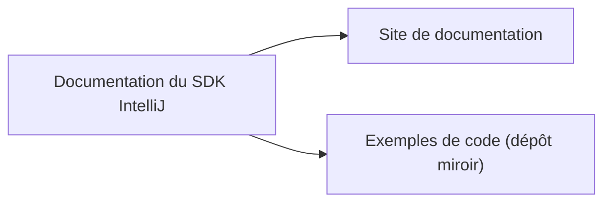

# JetBrains/intellij-sdk-docs

> Sources of the IntelliJ Platform SDK documentation, for plugin authors.

## The problem
Developers of plugins for JetBrains IDEs need reference documentation.

## What it actually does
The repository hosts the SDK documentation site; the very short README points to the code samples (mirror repository) and to the channels for reporting errors. Nothing else is described.

## How it is wired
Simplified diagram based on the fiche, no diagram provided.

## Trying it
No documented command: read the published site.

## Cost and gotchas
Free. README under 800 characters: the fiche remains minimal.

## What it is not
Not the SDK itself nor a plugin: documentation only.

## Alternatives
No alternative named in the README.

## For you
Ignore: useful only if you write plugins for a JetBrains IDE.
