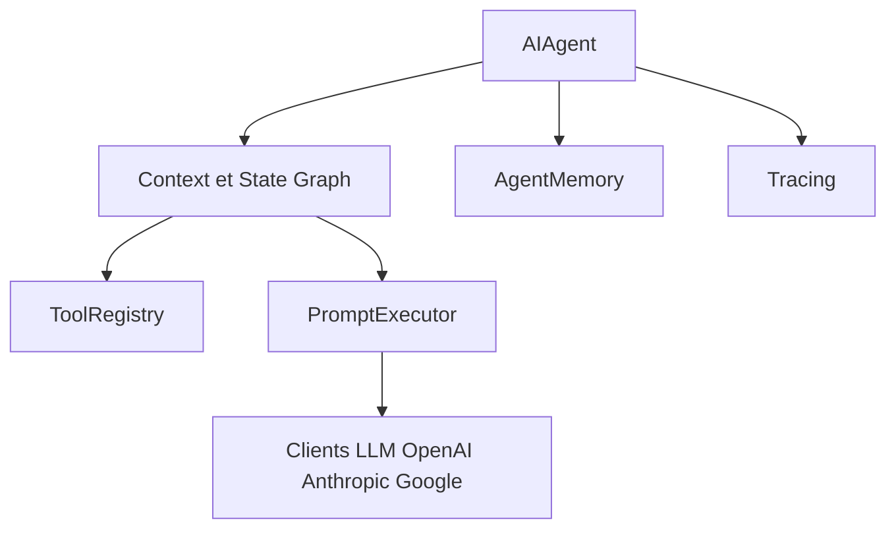

# JetBrains/koog

> Multiplatform Kotlin framework for building AI agents with tools and graph-based flows, on the JVM side.

## The problem
Agent frameworks are mostly in Python; a Kotlin/Java team wants an idiomatic, typed equivalent that integrates with Spring or Ktor.

## What it actually does
`AIAgent` relies on a prompt executor (OpenAI, Anthropic, Google, DeepSeek, OpenRouter, Ollama, Bedrock), tools, strategy graphs, persistent state recovery, history compression, memory/RAG, OpenTelemetry tracing (Weave, Langfuse), MCP and ACP. Targets: JVM, JS, Wasm, Android, iOS.

## How it is wired


## Trying it
```kotlin
implementation("ai.koog:koog-agents:1.3.0")
```
```kotlin
val agent = AIAgent(
    promptExecutor = MultiLLMPromptExecutor(OpenAILLMClient(apiKey)),
    systemPrompt = "You are a helpful assistant. Answer user questions concisely.",
    llmModel = OpenAIModels.Chat.GPT4o
)
```

## Cost and gotchas
JDK 17+, Kotlin 2.3.10+. The provider's API key is at your expense. 250 open issues. The "additions" module is in beta.

## What it is not
Not a Python tool. The architecture explanation provided is generic; do not take it for the exact module structure.

## Alternatives
- AgentScope Java: enterprise-oriented JVM agent framework, same batch.

## For you
Worth watching only if your stack is Kotlin/JVM; in Python, prefer a framework native to your ecosystem.
