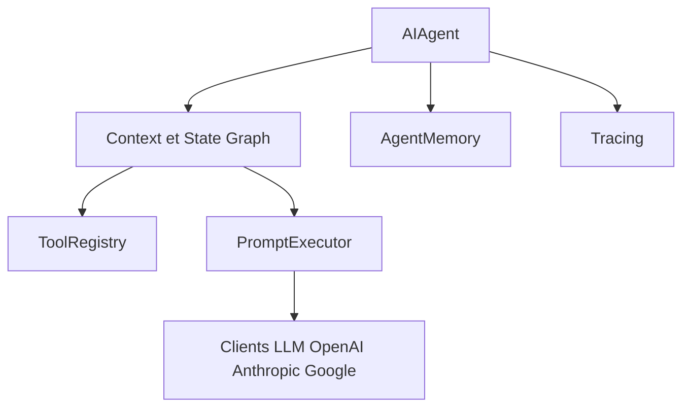

# JetBrains/koog

> Framework Kotlin multiplateforme pour construire des agents IA avec outils et flux en graphe, côté JVM.

## Le problème
Les frameworks d'agents sont surtout en Python ; une équipe Kotlin/Java veut un équivalent idiomatique, typé et intégrable à Spring ou Ktor.

## Ce que ça fait vraiment
`AIAgent` s'appuie sur un exécuteur de prompts (OpenAI, Anthropic, Google, DeepSeek, OpenRouter, Ollama, Bedrock), des outils, des graphes de stratégie, des reprises d'état persistantes, la compression d'historique, la mémoire/RAG, le traçage OpenTelemetry (Weave, Langfuse), MCP et ACP. Cibles JVM, JS, Wasm, Android, iOS.

## Comment c'est branché


## Essayer
```kotlin
implementation("ai.koog:koog-agents:1.3.0")
```
```kotlin
val agent = AIAgent(
    promptExecutor = MultiLLMPromptExecutor(OpenAILLMClient(apiKey)),
    systemPrompt = "You are a helpful assistant. Answer user questions concisely.",
    llmModel = OpenAIModels.Chat.GPT4o
)
```

## Coût et pièges
JDK 17+, Kotlin 2.3.10+. Clé du fournisseur à ta charge. 250 issues ouvertes. Le module « additions » est en bêta.

## Ce que ce n'est pas
Pas un outil Python. L'explication d'architecture fournie est générique ; ne la prends pas pour la structure exacte des modules.

## Alternatives
- AgentScope Java : framework JVM d'agents orienté entreprise, même lot.

## Pour toi
À surveiller seulement si ta stack est Kotlin/JVM ; en Python, préfère un framework natif de ton écosystème.

