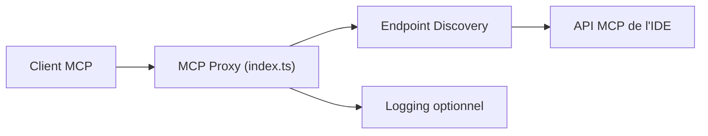

# JetBrains/mcp-jetbrains

> npm MCP proxy to JetBrains IDEs, deprecated since the native integration in the 2025.2 IDEs.

## The problem
An MCP client (Claude Desktop, VS Code) wanted to access the tools of a JetBrains IDE.

## What it actually does
A small Node proxy (`@jetbrains/mcp-proxy`) that discovers and refreshes the IDE's endpoint, lists the tools and relays calls and results over stdio. It requires the "MCP Server" plugin; settings `IDE_PORT`, `HOST`, `LOG_ENABLED`. The README states that the repository is no longer maintained.

## How it is wired


## Trying it
```json
{
  "mcpServers": {
    "jetbrains": {
      "command": "npx",
      "args": ["-y", "@jetbrains/mcp-proxy"]
    }
  }
}
```

## Cost and gotchas
Node 18+ (Node 16 fails). On macOS with nvm, you need a symlink of `npx` in `/usr/local/bin`. The repository is not archived but is announced as unmaintained.

## What it is not
No longer the recommended route: the MCP server built into JetBrains IDEs (SSE or JVM proxy) replaces it.

## Alternatives
The feature built into IntelliJ 2025.2+ IDEs, cited by the README.

## For you
Ignore: deprecated repository; use the JetBrains IDE's native MCP.
