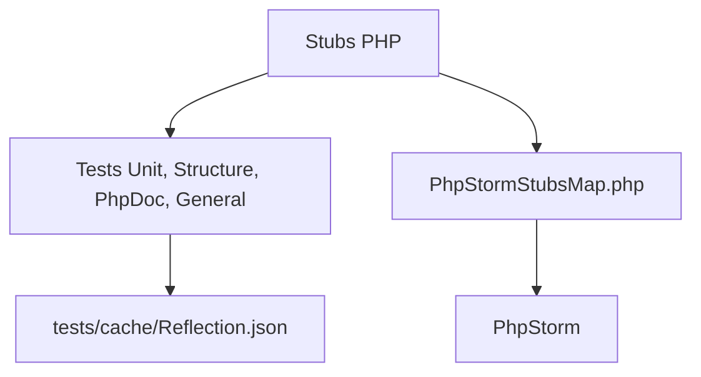

# JetBrains/phpstorm-stubs

> PHP signature files describing the native functions and classes, used by PhpStorm for analysis.

## The problem
An IDE needs reliable signatures and PHPDoc for completion, inspection and type inference on PHP's native elements.

## What it actually does
Provides syntactically valid PHP stubs for the PHP core and most extensions. Non-standard extensions are community-maintained and only their PHPDoc is validated. Tests run in a Docker image against reflection caches per PHP version. The `@throws` must be checked by hand.

## How it is wired
Simplified diagram based on the sheet, no diagram provided.


## Trying it
```bash
./runTests.sh
./runTests.sh --php-version 5.6
docker compose -f docker-compose.yml run --rm test_runner php tests/Framework/Tools/generate-stubs-map.php
```

## Cost and gotchas
Free. Docker required for the tests. Do not commit the caches regenerated with `--refresh-reflection`.

## What it is not
Not an executable tool: data for an IDE. Does not guarantee the fidelity of non-standard extensions.

## Alternatives
No alternative named in the README.

## For you
Ignore: specific to PhpStorm and PHP, no value for your data, AI or MLOps work.
