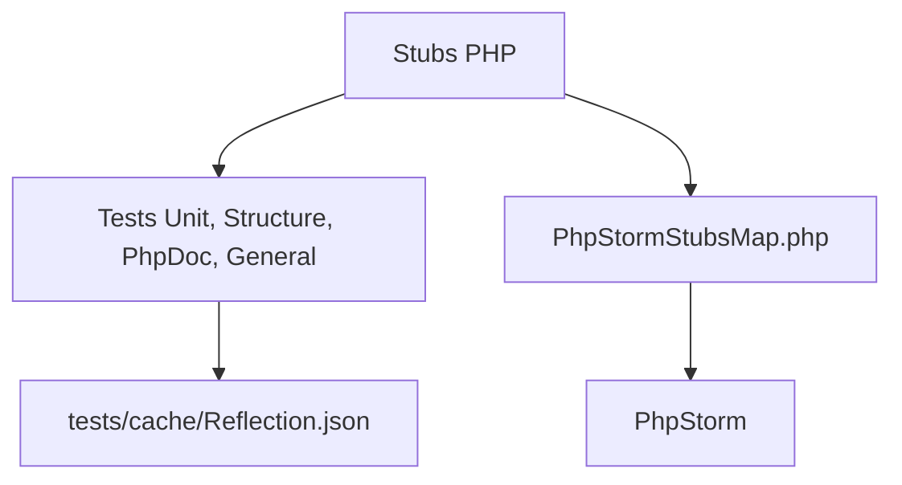

# JetBrains/phpstorm-stubs

> Fichiers PHP de signatures décrivant les fonctions et classes natives, utilisés par PhpStorm pour l'analyse.

## Le problème
Un IDE a besoin de signatures et de PHPDoc fiables pour la complétion, l'inspection et l'inférence de types sur les éléments natifs de PHP.

## Ce que ça fait vraiment
Fournit des stubs PHP syntaxiquement valides pour le cœur de PHP et la plupart des extensions. Les extensions non standard sont communautaires et seul leur PHPDoc est validé. Les tests s'exécutent dans une image Docker contre des caches de réflexion par version de PHP. Les `@throws` sont à vérifier à la main.

## Comment c'est branché
Schéma simplifié d'après la fiche, sans diagramme fourni.


## Essayer
```bash
./runTests.sh
./runTests.sh --php-version 5.6
docker compose -f docker-compose.yml run --rm test_runner php tests/Framework/Tools/generate-stubs-map.php
```

## Coût et pièges
Gratuit. Docker requis pour les tests. Ne pas committer les caches régénérés avec `--refresh-reflection`.

## Ce que ce n'est pas
Pas un outil exécutable : de la donnée pour IDE. Ne garantit pas la fidélité des extensions non standard.

## Alternatives
Aucune alternative nommée dans le README.

## Pour toi
Ignorer : spécifique à PhpStorm et PHP, sans valeur pour ton travail data, IA ou MLOps.

