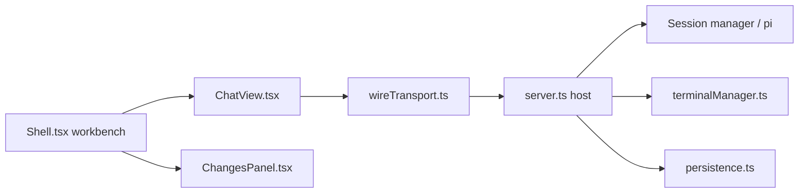

# JetBrains/thinkrail

> An agentic IDE from JetBrains built on the pi agent, with isolated workspaces and living specs.

## The problem
Coding agents modify your working directory and lose the project's intent between sessions.

## What it actually does
Each workspace is a `git worktree` with its own branch; several pi sessions per workspace, Monaco editor, terminals, commented diff review. `SPEC.md` files form a graph of specs read and maintained by the agent. Skills, GitHub PR workflows, MCP servers with confirmation. Desktop app or CLI that opens the interface in the browser.

## How it is wired


## Trying it
```bash
curl -fsSL https://raw.githubusercontent.com/JetBrains/thinkrail/main/install.sh | bash
thinkrail ~/code/my-repo
```

## Cost and gotchas
Free; the model provider is at your expense (JetBrains AI or your pi credentials). Requires git. Usage telemetry and error reports are sent with an installation identifier; on Linux and Windows, desktop builds are unsigned or only partially signed.

## What it is not
Not a full IDE: the agent is pi, not an in-house engine. Full extensions are announced, not delivered. Project less than four months old, 225 open issues.

## Alternatives
No alternative named in the README (it relies on pi).

## For you
Worth watching: the idea of one worktree per agent plus versioned specs is good for parallel workstreams, but the product is young and sends usage data by default.
