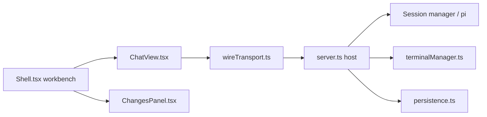

# JetBrains/thinkrail

> Un IDE agentique de JetBrains bâti sur l'agent pi, avec espaces de travail isolés et specs vivantes.

## Le problème
Les agents de code modifient ton dossier de travail et perdent l'intention du projet entre deux sessions.

## Ce que ça fait vraiment
Chaque espace est un `git worktree` avec sa branche ; plusieurs sessions pi par espace, éditeur Monaco, terminaux, revue de diffs commentée. Des fichiers `SPEC.md` forment un graphe de specs lu et tenu par l'agent. Skills, workflows de PR GitHub, serveurs MCP avec confirmation. App de bureau ou CLI ouvrant l'interface dans le navigateur.

## Comment c'est branché


## Essayer
```bash
curl -fsSL https://raw.githubusercontent.com/JetBrains/thinkrail/main/install.sh | bash
thinkrail ~/code/my-repo
```

## Coût et pièges
Gratuit ; fournisseur de modèle à ta charge (JetBrains AI ou tes identifiants pi). Requiert git. Télémétrie d'usage et rapports d'erreur envoyés avec un identifiant d'installation ; sur Linux et Windows, builds de bureau non signés ou partiellement signés.

## Ce que ce n'est pas
Pas un IDE complet : l'agent est pi, pas un moteur maison. Les extensions complètes sont annoncées, pas livrées. Projet de moins de quatre mois, 225 issues ouvertes.

## Alternatives
Aucune alternative nommée dans le README (il s'appuie sur pi).

## Pour toi
Surveiller : l'idée worktree par agent plus specs versionnées est bonne pour des chantiers parallèles, mais le produit est jeune et envoie des données d'usage par défaut.

