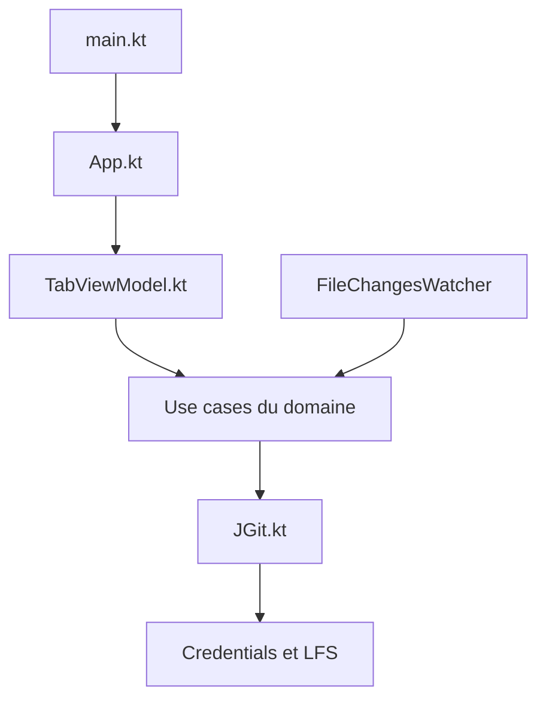

# JetpackDuba/Gitnuro

> Cross-platform desktop Git client in Kotlin Compose and JGit, with no web technologies.

## The problem
Graphical Git clients are either proprietary or embedded web applications.

## What it actually does
History and diffs (side by side), staging by hunk or line, commit, amend, merge, interactive rebase, stash, tags, blame, submodules, LFS, JSON themes. One tab per repository with per-tab dependency injection. Watches the file system to refresh the display. No data collection announced.

## How it is wired
Diagram based on the code's diagram.



## Trying it
```bash
flatpak install com.jetpackduba.Gitnuro
brew install jetpackduba/apps/gitnuro
# JAR portable : nécessite JRE 17
```

## Cost and gotchas
Free, GPL-3.0 (copyleft). The macOS version is unsigned. Authentication fails with some setups (mDNS, self-signed certificate). JRE 17 for the JAR version.

## What it is not
Not a web interface nor a service. Patches and several options are still on a waiting list.

## Alternatives
No alternative named in the README.

## For you
Worth watching: if you are looking for a free, lightweight graphical Git client; nothing specific to data or AI.
