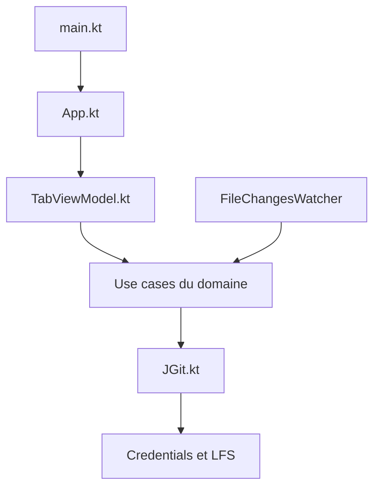

# JetpackDuba/Gitnuro

> Client Git de bureau multiplateforme en Kotlin Compose et JGit, sans technologies web.

## Le problème
Les clients Git graphiques sont soit propriétaires, soit des applications web embarquées.

## Ce que ça fait vraiment
Historique et diffs (côte à côte), indexation par hunk ou ligne, commit, amend, merge, rebase interactif, stash, tags, blame, sous-modules, LFS, thèmes JSON. Onglets par dépôt avec injection de dépendances par onglet. Surveille le système de fichiers pour rafraîchir l'affichage. Aucune collecte de données annoncée.

## Comment c'est branché
Schéma d'après le diagramme du code.



## Essayer
```bash
flatpak install com.jetpackduba.Gitnuro
brew install jetpackduba/apps/gitnuro
# JAR portable : nécessite JRE 17
```

## Coût et pièges
Gratuit, GPL-3.0 (copyleft). Version macOS non signée. Authentification en échec avec certains setups (mDNS, certificat auto-signé). JRE 17 pour la version JAR.

## Ce que ce n'est pas
Pas une interface web ni un service. Les patches et plusieurs options sont encore en liste d'attente.

## Alternatives
Aucune alternative nommée dans le README.

## Pour toi
À surveiller : si tu cherches un client Git graphique libre et léger ; rien de spécifique à la data ou à l'IA.

