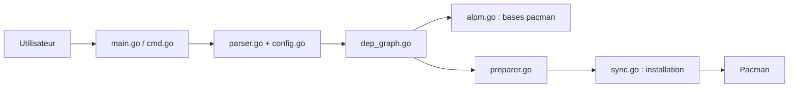

# Jguer/yay

> Command-line helper for installing and updating Arch Linux packages, from the official repositories and the AUR.

## The problem
On Arch, installing an AUR package means cloning the PKGBUILD, resolving dependencies and running makepkg by hand.

## What it actually does
Resolves dependencies up front, downloads PKGBUILDs (ABS or AUR), asks all its questions before starting any build, then installs through pacman. It also handles `-git` packages (development hash database), progressive search, AUR voting and cleanup of build dependencies.

## How it is wired


## Trying it
```bash
sudo pacman -S --needed git base-devel
git clone https://aur.archlinux.org/yay.git
cd yay
makepkg -si
yay -Syu --devel
```

## Cost and gotchas
Free. It runs PKGBUILDs from the AUR: reading them beforehand remains your responsibility. Voting requires `AUR_USERNAME` and `AUR_PASSWORD` as environment variables.

## What it is not
Not a multi-distribution tool: it only works with pacman. Problems caused by editing a PKGBUILD during installation are not supported.

## Alternatives
- paru: another AUR helper mentioned in the README.
- aurutils: a more modular approach.
- pikaur: another AUR helper.

## For you
Ignore for data/AI watch: this is Arch package management, useful only if your work machine runs Arch.
