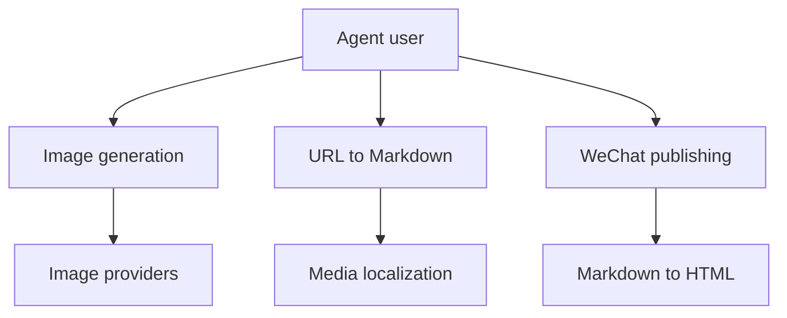

# JimLiu/baoyu-skills

> More than twenty skills for agents (Claude Code, Codex): images, infographics, conversion and publishing.

## The problem
Producing and publishing content (cards, covers, articles) from an agent, without chaining tools by hand.

## What it actually does
Skills for generation (Xiaohongshu cards, infographics, comics, covers, slides), SVG diagrams, conversion (URL to Markdown, Markdown to HTML) and publishing (WeChat, X, Weibo). The scripts go through Chrome driven via CDP or through the WeChat API. The README is truncated in the source material.

## How it is wired


## Trying it
```bash
npx skills add jimliu/baoyu-skills
/plugin marketplace add JimLiu/baoyu-skills
/baoyu-infographic path/to/content.md
```

## Cost and gotchas
Node and `npx bun` required. Image generation goes through third-party providers (keys at your expense); WeChat credentials in `.env`, not to be committed. Installing everything bloats the agent's context.

## What it is not
Not a single tool: a collection of skills to install à la carte. Oriented toward Chinese content and social networks.

## Alternatives
- JimLiu/baoyu-design: separate project, oriented toward HTML design.

## For you
Worth watching: little link with data/MLOps; only the diagram or conversion skills may be useful.
