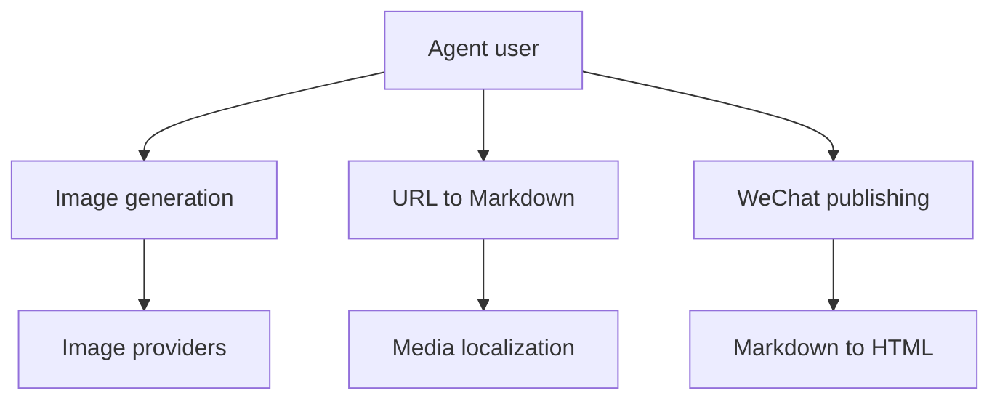

# JimLiu/baoyu-skills

> Plus de vingt skills pour agents (Claude Code, Codex) : images, infographies, conversion et publication.

## Le problème
Produire et publier du contenu (cartes, couvertures, articles) depuis un agent, sans enchaîner les outils à la main.

## Ce que ça fait vraiment
Skills de génération (cartes Xiaohongshu, infographies, bandes dessinées, couvertures, slides), de diagrammes SVG, de conversion (URL vers Markdown, Markdown vers HTML) et de publication (WeChat, X, Weibo). Les scripts passent par Chrome piloté en CDP ou par l'API WeChat. Le README est tronqué dans la matière.

## Comment c'est branché


## Essayer
```bash
npx skills add jimliu/baoyu-skills
/plugin marketplace add JimLiu/baoyu-skills
/baoyu-infographic path/to/content.md
```

## Coût et pièges
Node et `npx bun` requis. La génération d'images passe par des fournisseurs tiers (clés à ta charge) ; identifiants WeChat dans `.env`, à ne pas commiter. Tout installer alourdit le contexte de l'agent.

## Ce que ce n'est pas
Pas un seul outil : un recueil de skills à installer à la carte. Orienté contenu et réseaux chinois.

## Alternatives
- JimLiu/baoyu-design : projet séparé, orienté design HTML.

## Pour toi
À surveiller : peu de lien avec data/MLOps ; seuls les skills de diagrammes ou de conversion peuvent servir.

